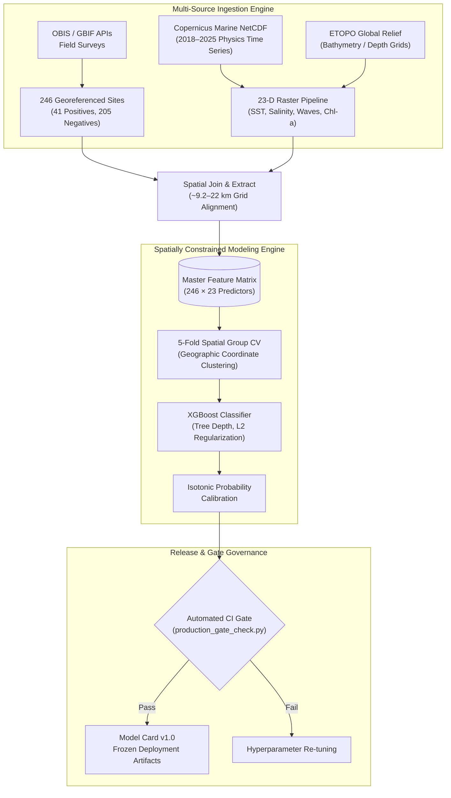

# Geospatial Ecological AI for Marine Cultivation Suitability

[](https://www.python.org/)
[](https://xgboost.readthedocs.io/)
[](https://marine.copernicus.eu/)
[](#4-spatial-validation-methodology)
[](docs/MODEL_CARD_v1.0.md)
[](LICENSE)

An end-to-end, reproducible Earth observation and machine learning system for regional ecological suitability screening of *Kappaphycus alvarezii* macroalgae cultivation along the Gulf of Mannar continental shelf.

---

## 1. Scientific Motivation & Problem Statement

Marine macroalgae cultivation represents a vital bio-economy sector, yet site selection in tropical coastal shelves faces severe empirical constraints:
- **Regional Data Scarcity:** Standard presence records in marine biodiversity portals (OBIS, GBIF) are sparse, uncalibrated, and subject to geographic sampling bias.
- **Spatial Autocorrelation Leakage:** Standard random $K$-fold cross-validation inflates predictive performance because nearby spatial coordinates share latent environmental factors. Without spatially segregated folds, models report artificially high accuracy while failing to generalize to adjacent coastal sectors.
- **Extreme Oceanographic Variance:** Tropical macroalgae suffer die-offs from combined stressors: sea surface temperature (SST) variance, marine heat stress days, salinity shock from seasonal monsoons, and extreme wave dissipation.

This repository implements a **spatially disciplined machine learning pipeline** that fuses Copernicus Marine NetCDF oceanography, high-resolution ETOPO bathymetry, and spatial group cross-validation to provide verified ecological screening.

---

## 2. Key Capabilities & Pipeline Overview

- **Project-Specific Occurrence Dataset:** Built a curated dataset across **246 georeferenced marine locations (41 occurrence positives, 205 hard-negative/background samples)** along the Gulf of Mannar shelf via OBIS/GBIF APIs, surveys, and multi-temporal satellite digitization (<= 1.0 km precision).
- **23-Dimensional Oceanographic Feature Store:** Automated raster engine extracting multi-year physical variables (2018–2025) from Copernicus Marine Service NetCDF time series and ETOPO bathymetry resampled to a unified grid (~9.2–22 km resolution).
- **Spatial Group Cross-Validation:** Coordinates are clustered into **5 spatially disjoint geographic blocks**, mitigating spatial autocorrelation leakage during model hyperparameter tuning.
- **Isotonic Probability Calibration:** Calibrates raw classifier output scores to true posterior probabilities of occurrence, enabling reliable risk thresholding.
- **Production CI Gate Checking:** Implements deterministic threshold sweep and release verification gates (`production_gate_check.py`) enforcing strict quality criteria prior to model snapshot freezing.

---

## 3. System Architecture & ETL Flow



---

## 4. Spatial Validation & Model Card v1.0 Summary

The model is evaluated under strict Spatial Group Cross-Validation where no geographic cluster appears simultaneously in training and test splits:

| Metric | Measured Value | Standard / Protocol |
| :--- | :---: | :--- |
| **Geographic Scope** | Gulf of Mannar Shelf | Lon `[78.51, 79.79]`, Lat `[9.03, 9.77]` |
| **Total Occurrence Locations** | `246` Sites | 41 Positives, 205 Background / Negatives |
| **Spatial Validation Splits** | `5` Spatial Folds | Coordinate-based spatial clustering |
| **Spatial-CV ROC-AUC** | **`0.9288 ± 0.1226`** | Out-of-fold spatial cross-validation |
| **Spatial Average Precision (AP)** | **`0.9042`** | Spatial precision-recall curve integration |
| **Out-of-Fold Brier Score** | **`0.0944`** | Post-isotonic calibration |
| **Operating Threshold** | `0.6428` | Precision: **0.7500**, Recall: **0.8571** |
| **Priority Classification Policy** | High: >= 0.80 · Medium: >= 0.60 | Suitability screening tiering |

*For complete validation diagnostics, calibration curves, and feature importance rankings, see [docs/MODEL_CARD_v1.0.md](docs/MODEL_CARD_v1.0.md).*

---

## 5. Oceanographic Feature Representation (23 Predictors)

The master feature matrix encompasses physical oceanographic variables governing macroalgae metabolic physiology:

1. **Thermal Stress Regimes:** Mean SST, SST maximum, SST standard deviation, degree heating weeks / marine heat stress days.
2. **Salinity & Freshwater Influx:** Mean salinity, salinity minimum, seasonal salinity shock variance (monsoon run-off indicator).
3. **Hydrodynamics & Kinetic Energy:** Significant wave height, peak wave period, current velocities ($u$- and $v$-vectors).
4. **Bathymetry & Topography:** Seafloor depth (ETOPO), distance to shelf break, coastal proximity gradient.
5. **Biogeochemistry:** Chlorophyll-$a$ surface concentration (Copernicus optical observation).

---

## 6. Repository Layout

```
Strong-Seaweed/
├── run_verified_pack_to_gate.py        # Master end-to-end pipeline execution runner
├── production_gate_check.py            # Automated CI gate verifying release performance
├── project_paths.py                    # Unified spatial path & directory resolver
├── train_xgboost_model.py              # Core XGBoost training with 5-fold Spatial Group CV
├── train_realtime_production.py        # Production training harness with release tagging
├── score_realtime_production.py        # Real-time spatial scoring & raster generation
├── threshold_sweep_report.py           # Operating threshold precision/recall sweep
├── build_feature_matrix.py             # 23-D spatial join and raster sampling engine
├── download_copernicus_data.py         # Copernicus Marine API NetCDF ingestion client
├── align_to_depth_grid.py              # ETOPO bathymetry alignment & depth normalization
├── build_cyclone_exposure.py           # Extreme wave & cyclone exposure risk indexing
├── mine_hard_negatives.py              # High-salinity / unsuitable regime negative mining
├── data/                               # Copernicus NetCDF series, rasters, and occurrence CSVs
├── models/                             # Trained XGBoost models & serialized pipelines
├── artifacts/                          # Diagnostic reports, SHAP metrics, and test outputs
├── docs/                               # Formal model cards and validation audit reports
│   └── MODEL_CARD_v1.0.md              # Complete empirical Model Card (ROC-AUC 0.9288)
├── releases/                           # Semantic versioned frozen deployment checkpoints
├── PROJECT_STRUCTURE.md                # Detailed project architecture & directory specification
├── RELEASES.md                         # Release history, version tags, and performance milestones
├── requirements.txt                    # Pinned Python dependencies (xarray, netcdf4, xgboost)
├── .gitignore                          # Strict exclusions for bytecode, NetCDFs, and rasters
└── README.md                           # System architecture and technical documentation
```

---

## 7. Prerequisites & Installation

```bash
# Clone the repository
git clone https://github.com/Anas18102004/Strong-Seaweed.git
cd Strong-Seaweed

# Create and activate virtual environment
python -m venv venv
source venv/bin/activate  # On Windows: venv\Scripts\activate

# Install required packages
pip install -r requirements.txt
```

---

## 8. Reproducibility & Execution Workflows

### 1. Run Automated Production Gate Check

Verify that the model meets the strict validation standards set in Model Card v1.0:

```bash
python production_gate_check.py
```

### 2. Train and Validate Model Under Spatial Cross-Validation

```bash
python train_xgboost_model.py
```

### 3. Generate Release Artifacts (Semantic Tagging)

```bash
python train_realtime_production.py --release_tag v1.1
python score_realtime_production.py --release_tag v1.1 --snapshot_baseline
```

---

## 9. Known Limitations & Disclosures

- **Spatial Scope:** Calibrated specifically for the Gulf of Mannar continental shelf; pan-India extrapolation requires localized fine-tuning and regional background sampling.
- **Coarsest Sensor Resolution:** Wave height NetCDF layers operate at ~0.20 deg (~22 km), representing the upper bound on spatial resolution. Local hydrodynamic micro-eddies (< 1 km) require downscaled coastal bathymetry models.

---

## 10. License & Citation

Distributed under the **MIT License**.

```bibtex
@software{africawala2026strongseaweed,
  author = {Africawala, Mohammad Anas},
  title = {Geospatial Ecological AI for Marine Cultivation Suitability Screening},
  year = {2026},
  publisher = {GitHub},
  url = {https://github.com/Anas18102004/Strong-Seaweed}
}
```
